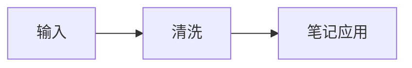

# 考研复习笔记

从 AI 回答，到你的知识库。

## 01 · 高等数学

当 \(x \to 0\) 时，利用等价无穷小：

\[
\begin{aligned}
\sin x &\sim x \\
1-\cos x &\sim \frac{x^2}{2}
\end{aligned}
\]

> [!note]
> 先判断端点，再讨论参数。[[反常积分]] ==重点==

## 02 · 计算机组成原理

CPU 的执行时间：\(T = IC \times CPI \times T_c\)。

| 指标 | 含义 | 单位 |
| --- | --- | --- |
| 时钟频率 | 每秒时钟周期数 | Hz |
| CPI | 每条指令平均周期数 | 周期 |

## 03 · 数据结构

```c
// 保留代码中的定界符与缩进
printf("\\(hello\\)");
int binary_search(int a[], int n, int key) {
    int low = 0, high = n - 1;
    while (low <= high) {
        int mid = low + (high - low) / 2;
        if (a[mid] == key) return mid;
        if (a[mid] < key) low = mid + 1;
        else high = mid - 1;
    }
    return -1;
}
```



- [x] 理解时间复杂度
- [ ] 完成课后练习

中文与 English 混排 👩‍💻。参考资料 citeturn0search1
